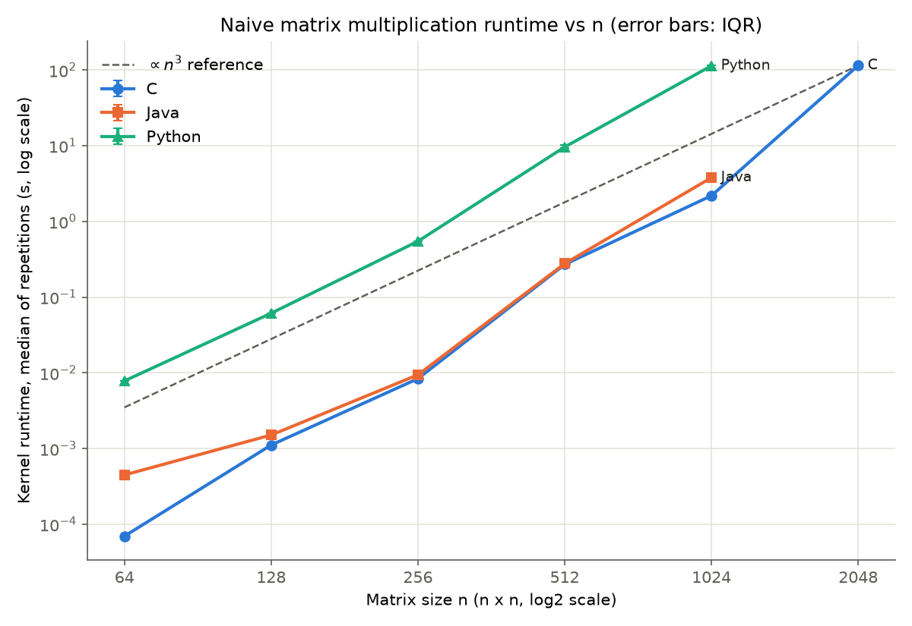
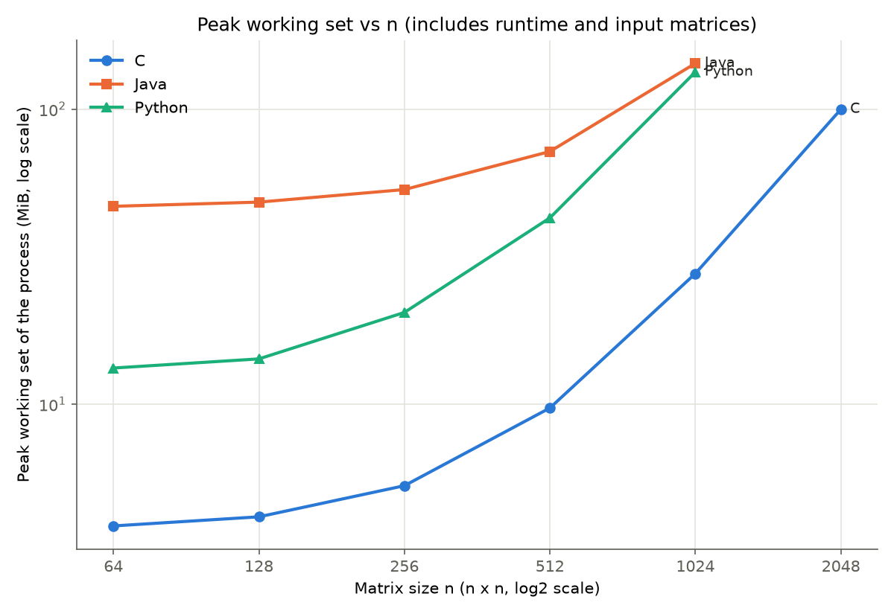

# How Matrix Size Affects the Runtime and Memory of Naive Matrix Multiplication in Python, Java and C

**Author:** Joel López Guillén  
**Assignment:** 1 — Basic Matrix Multiplication in Different Languages  
**Course:** BIG DATA, Grado en Ciencia e Ingeniería de Datos, Universidad de Las Palmas de Gran Canaria, 2026-2027  
**Repository:** https://github.com/JoelLopezGuillen/big-data-matrix-multiplication

---

## Abstract

This study measures how the matrix size *n* affects the runtime and peak memory of the same naive i-j-k
triple-loop dense matrix multiplication implemented in C, Java and Python on a single laptop
(Intel Core i7-12650H, Windows 11). All implementations read identical float64 input matrices, were
validated against NumPy, and were timed over five repetitions after warm-up runs, reporting the median
and interquartile range. Runtime did not follow a single cubic curve: the time per inner-loop iteration
stayed roughly constant while the strided operand fitted in one cache level and rose sharply each time it
exceeded one (in C: 0.27, 0.5, 2.0 and 13.3 ns per iteration). C and Java performed similarly from n = 256
to 512, while CPython was 36–112 times slower than C at the sizes where both completed. The largest feasible sizes within a
900 s per-process budget were 2048 for C and 1024 for Java and Python; a supplementary run showed that
the Java timeout at n = 2048 was caused by the budget design, not by infeasibility. These conclusions
apply only to the tested implementations, settings, inputs and machine.

## 1. Introduction and objective

Dense matrix multiplication is a standard benchmark kernel because its arithmetic work grows as O(n³)
while its data grows as O(n²), so it stresses both the processor and the memory hierarchy [3], [11].
Implementing the same algorithm in languages with different execution models (ahead-of-time compiled C,
JIT-compiled Java and interpreted CPython) makes it possible to observe how execution model and memory
layout affect performance under controlled conditions.

**Research question.** How does the matrix size *n* affect the runtime and peak memory of the same naive
triple-loop dense matrix multiplication implemented in Python, Java and C, on one fixed machine?

**Hypotheses (stated before the main results were analysed).**

- **H1.** Runtime grows approximately as n³, i.e. by a factor of about 8 each time n doubles.
- **H2.** C and Java, which execute native machine code, are much faster than CPython, which interprets bytecode.
- **H3.** In Python, interpreter overhead dominates each operation, so memory-hierarchy effects should be
  smaller than in C and Java and growth should stay closer to ×8.

## 2. Background

**Naive matrix multiplication.** For C = A·B with n × n matrices, each element C[i][j] is the dot product
of row *i* of A and column *j* of B. The classic i-j-k triple loop performs n³ multiply-add operations,
so doubling n multiplies the arithmetic work by 2³ = 8.

**Row-major storage and access pattern.** In row-major order, consecutive elements of a row are adjacent
in memory, and element (i, k) of a flat array is at index i·n + k. In the i-j-k order the inner loop reads
A[i][k] contiguously but reads B[k][j] with a stride of n elements (8n bytes), touching a different cache
line on every iteration.

**Memory hierarchy.** Processors move data between memory levels in cache lines (64 bytes on x86).
Each level is larger and slower than the previous one: L1, L2, L3 and main memory [3], [4]. When the data a
loop reuses no longer fits in a level, accesses are served by the next, slower level. On the test machine
each performance core has a 48 KB L1 data cache and a 1.25 MB L2 cache, and the 24 MB L3 cache is
shared [2], [12].

**Execution models.** C is compiled ahead of time by gcc to native code. Java is compiled to bytecode that
the HotSpot JVM first interprets and then compiles just-in-time to optimised native code for frequently
executed ("hot") methods [5]; measurements taken before this happens are not representative, which is why
warm-up runs are needed [10]. CPython interprets bytecode and represents every number as a heap-allocated
object, so each arithmetic operation involves type checks and object management.

**Benchmarking pitfalls.** Measurements must use a monotonic clock, exclude warm-up runs, and consume the
result so that the compiler cannot remove the computation as dead code [1], [10].

## 3. Methodology

### 3.1 Implementations

All three implementations use the same algorithm: the i-j-k triple loop, accumulating the dot product in
a local variable and then writing `C[i][j] = sum`. No optimised matrix multiplication library is used in
any implementation.

- **C and Java** store each matrix as a flat row-major `double` array of length n², indexed as `i*n + k`.
- **Python** uses a list of lists of `float`, the idiomatic representation in pure Python. This is an
  unavoidable language-specific difference: each element is an 8-byte pointer to a separate float object
  (about 24 bytes), instead of an 8-byte value stored contiguously.
- The Python version stores the current row of A in a local variable (`a_row = a[i]`) outside the inner
  loops. gcc performs an equivalent optimisation automatically at `-O2`.
- The output matrix is allocated and zero-initialised inside the multiplication function (`calloc` in C,
  `new double[]` in Java, a list comprehension in Python).

### 3.2 Inputs

To compare the three languages fairly, all of them must multiply exactly the same matrices. Each programming language has its own random number generator, so generating the matrices separately in C, Java and Python would produce different inputs. Instead, the input matrices A and B were generated once for each size by a Python script (`data/generate.py`) and saved to files that all three implementations read [1].

The values are random numbers between -1 and 1 (uniform distribution over [-1, 1)), stored as 64-bit floating-point numbers (float64). They were generated with NumPy’s `default_rng` generator using fixed seeds (42 for A and 43 for B), so running the script again produces exactly the same matrices. The files store the raw binary values row by row (little-endian, row-major order), which avoids any loss of precision from converting numbers to text.
### 3.3 Environment

| Item | Value |
|---|---|
| CPU | Intel Core i7-12650H: 6 performance cores (P-cores, Hyper-Threading) and 4 efficiency cores (E-cores); 10 physical cores, 16 logical processors |
| Caches (P-core) | L1d 48 KB and L2 1.25 MB per core; L3 24 MB shared; 64-byte lines (reported by Windows [12]) |
| RAM | 15.7 GiB |
| OS | Windows 11 (build 10.0.26200) |
| C | gcc 16.1.0 (MSYS2 UCRT64), flags `-O2 -std=c11 -Wall -Wextra` |
| Java | Oracle JDK 21.0.10 (HotSpot), compiled with `javac --release 21`, run with `-Xms4g -Xmx4g -XX:+UseSerialGC` |
| Python | CPython 3.13.7 |
| Measurement tools | psutil 7.2.2, NumPy 2.5.4 (reference only) |

Because the i7-12650H is a hybrid processor, it has two kinds of cores: fast performance cores (P-cores) and slower efficiency cores (E-cores). The operating system can move a running program from one core to another at any time. If this happened during a measurement, part of the run would be timed on a fast core and part on a slow one, making the results unreliable. To avoid this, we first checked which logical processors belong to the P-cores using a Windows function (`GetSystemCpuSetInformation`) [9]: processors 0–11 are P-cores and 12–15 are E-cores. Every benchmark process was then restricted to processors 0–11 and given high priority, so that other programs would interfere as little as possible. All implementations use a single thread. During the runs, the laptop was plugged in and heavy applications were closed.

These settings were the same for every configuration of the main run.

### 3.4 Measurement protocol

- **Timing boundary.** Only the multiplication kernel is timed, including allocation and zero-initialisation
  of the output matrix. Loading the input files happens before the timed region.
- **Timers.** Monotonic high-resolution timers were used: `QueryPerformanceCounter` in C (10 MHz, i.e.
  100 ns resolution on this machine) [8], `System.nanoTime` in Java, and `time.perf_counter_ns` in Python [6].
- **Process structure.** Each (language, n) configuration ran as one process that loaded the inputs,
  performed the warm-up runs and then five measured repetitions. Warm-up runs were excluded from the
  samples: 5 for Java (to let the JIT compiler optimise the kernel) and 1 for C and Python (to warm caches
  and memory pages).
- **Result consumption.** After each multiplication, the sum of all elements of C (checksum) was computed
  outside the timed region and reported, so the computation cannot be eliminated.
- **Memory metric.** Peak working set (`peak_wset`, the peak amount of physical memory used by the
  process) was read with psutil [7] by an external harness for all three languages. Because Windows only
  exposes this value while the process exists, each benchmark process prints its results and then waits
  on standard input; the harness reads the peak working set and then releases the process. This metric
  covers the whole process: runtime (JVM or interpreter), loaded inputs and output.
- **Statistics.** Every raw measurement was stored in CSV. For each configuration the median and the
  interquartile range (IQR = Q3 − Q1) of the five repetitions are reported.

### 3.5 Correctness

Before benchmarking, we checked that every implementation computes the correct result. Each one passed unit tests with small cases of known answer: multiplication by the identity matrix, by a zero matrix, and two hand-calculated examples (2 × 2 and 3 × 3).

We also compared the results of all three implementations for n = 64 and n = 128 with NumPy, using the script `cross_check.py`. Exact equality is not expected, because computers round decimal numbers and NumPy adds the values in a different order than our loop. We therefore accepted tiny differences (`numpy.allclose` with a relative tolerance of 10⁻⁹ and an absolute tolerance of 10⁻¹²), strict enough to detect any real error. The largest difference reported by `cross_check.py` was 5.3 × 10⁻¹⁵, far below the tolerance.

### 3.6 Sizes and budget

The declared size sequence was n = 64, 128, 256, 512, 1024, 2048 and 4096. Each process had a budget of
900 s, covering warm-ups and the five repetitions. A configuration that exceeded the budget was killed and
recorded as a timeout with its limit, and larger sizes for that language were skipped, since doubling n
multiplies the work by eight. Memory was not a limiting factor: three float64 matrices at n = 4096 need
about 400 MB.

## 4. Results

### 4.1 Runtime

**Table 1.** Kernel runtime: median and IQR of 5 repetitions (seconds). Timeouts at 900 s per process.

| n | C median | C IQR | Java median | Java IQR | Python median | Python IQR |
|---|---|---|---|---|---|---|
| 64 | 0.0000696 | 0.0000012 | 0.000448 | 0.000029 | 0.00781 | 0.00002 |
| 128 | 0.00111 | 0.00002 | 0.00151 | 0.00001 | 0.0613 | 0.0002 |
| 256 | 0.00837 | 0.00004 | 0.00941 | 0.00016 | 0.546 | 0.004 |
| 512 | 0.270 | 0.003 | 0.277 | 0.011 | 9.60 | 0.94 |
| 1024 | 2.18 | 0.04 | 3.78 | 0.23 | 113.6 | 11.3 |
| 2048 | 114.5 | 5.5 | timeout | — | timeout | — |
| 4096 | timeout | — | skipped | — | skipped | — |

**Figure 1.** Kernel runtime against n (log-log scale), with error bars showing the IQR and a dashed n³
reference line.

The largest feasible tested size was n = 2048 for C and n = 1024 for Java and Python. The largest size
attempted was 4096 for C and 2048 for Java and Python.

**Table 2.** Growth ratio T(n)/T(n/2) of the median runtime. A purely cubic algorithm gives 8.

| n | C | Java | Python |
|---|---|---|---|
| 128 | 16.0 | 3.4 | 7.8 |
| 256 | 7.5 | 6.2 | 8.9 |
| 512 | 32.3 | 29.4 | 17.6 |
| 1024 | 8.1 | 13.7 | 11.8 |
| 2048 | 52.4 | — | — |

**Table 3.** Time per inner-loop iteration, T/n³ (nanoseconds). A purely cubic cost gives a constant value.
The last column gives the size of B (8n² bytes), the operand read with stride n.

| n | C | Java | Python | Size of B |
|---|---|---|---|---|
| 64 | 0.27 | 1.71 | 29.8 | 32 KB |
| 128 | 0.53 | 0.72 | 29.2 | 128 KB |
| 256 | 0.50 | 0.56 | 32.5 | 512 KB |
| 512 | 2.01 | 2.06 | 71.6 | 2 MB |
| 1024 | 2.03 | 3.52 | 105.8 | 8 MB |
| 2048 | 13.33 | — | — | 32 MB |

Variability was low: the IQR was below 2.5 % of the median for every C configuration up to n = 1024,
and at most 6.4 % for Java. It increased for long runs: 4.8 % for C at n = 2048 and about 10 % for
Python at n = 512 and 1024.

### 4.2 Memory

**Table 4.** Peak working set of the whole process (MiB).

| n | C | Java | Python |
|---|---|---|---|
| 64 | 3.9 | 46.8 | 13.3 |
| 128 | 4.2 | 48.4 | 14.2 |
| 256 | 5.3 | 53.4 | 20.5 |
| 512 | 9.7 | 71.8 | 42.8 |
| 1024 | 27.7 | 142.9 | 133.6 |
| 2048 | 99.8 | — | — |

**Figure 2.** Peak working set against n.

### 4.3 Supplementary experiment: Java at n = 2048 with one warm-up

While analysing the main run, we found a bias in the budget design. Because the 900 s limit covered the
whole process, Java (5 warm-ups + 5 repetitions = 10 multiplications) had a stricter effective limit than
C and Python (1 + 5 = 6 multiplications). The Java timeout at n = 2048 could therefore reflect the number
of warm-ups rather than the cost of one multiplication.

To test this, Java at n = 2048 was run again separately, with the same inputs, flags and pinning, one
warm-up run (the same number as C) and a 2700 s budget. This run took place later on the same day as the
main run (2026-10-14, 21:45), so its thermal and background conditions may differ. Its results are
reported separately and are not merged into Tables 1–4.

**Table 5.** Supplementary run compared with C at n = 2048 from the main run.

| | C (main run) | Java (supplementary) |
|---|---|---|
| Warm-ups | 1 | 1 |
| Median (s) | 114.5 | 129.2 |
| IQR (s) | 5.5 | 9.8 |
| Repetitions (s) | 121.4, 112.3, 108.6, 114.5, 117.9 | 119.8, 124.7, 138.7, 134.4, 129.2 |
| Peak working set (MiB) | 99.8 | 303.3 |
| Checksum | −23415.104678236432 | −23415.104678236432 |

The whole Java process took about 13 minutes, so with one warm-up it would have fitted the original
900 s budget. With five warm-ups (about 10 × 129 s ≈ 21 min) it would not. This confirms that the main-run
timeout was caused by the budget design.

## 5. Discussion

**Growth compared with the cubic model (H1).** The runtime did not grow by a constant factor of 8. When n
doubled and the strided operand B stayed within the same cache level, the ratio was close to 8 (C: 7.5
from 128 to 256 and 8.1 from 512 to 1024). When B crossed into the next level, the ratio jumped (C: 16 at
64→128, 32.3 at 256→512 and 52.4 at 1024→2048). Table 3 shows this more clearly. In C the time per
iteration forms steps of 0.27 ns, about 0.5 ns, about 2.0 ns and 13.3 ns. These steps match B fitting in L1
(32 KB < 48 KB), L2 (128–512 KB < 1.25 MB), L3 (2–8 MB < 24 MB), and finally exceeding L3 (32 MB). This
explanation is consistent with the data, but it is not proven, because cache misses were not measured with
hardware counters. A complementary explanation is that power-of-two strides map many elements of a column
of B to the same cache sets, causing conflict misses. Because every tested size was a power of two, the
two effects cannot be separated here; comparing, for example, n = 1000 with n = 1024 could test this. In
summary, the algorithm performs n³ operations, but the cost per operation depends on where the data is
stored. H1 holds only within a cache level.

**Execution models (H2).** H2 is supported. CPython was between 36 and 112 times slower than C (Table 1). The ratio
was largest at small sizes (112 at n = 64), where C ran from the fastest cache level. Each Python
iteration costs about 30 ns even when the data fits in cache, because the interpreter dispatches bytecode,
checks types and creates a new float object for each intermediate result. Java was close to C at
n = 256 and n = 512 (1.12 and 1.02 times the C runtime), which is consistent with HotSpot compiling the kernel to native code. Java was slower at
n = 64 (1.71 ns per iteration against 0.27 ns). A plausible cause is that five warm-ups of a very small
problem may not trigger full optimisation, or that fixed per-call costs dominate at that size; this was
not investigated. At n = 1024, Java needed 1.73 times the C runtime. Possible explanations, such as array
bounds checks or differences in the generated code, were not tested. In the supplementary run the gap
narrowed to 1.13 at n = 2048. This is consistent with both implementations being limited by main-memory
access at that size, which reduces the weight of language-specific differences.

**Python and the memory hierarchy (H3).** H3 is only partly supported. As predicted, the growth ratio
stayed close to 8 for small sizes (7.8 and 8.9). However, it reached 17.6 from 256 to 512, and the time per
iteration rose from about 30 ns to 106 ns. Memory effects therefore matter in Python too, although less
than in C. A plausible reason is that a list of lists stores about 32 bytes per element (a pointer plus a
float object) instead of 8, and the float objects are scattered across the heap. B therefore exceeds each
cache level at smaller n than in C, and its accesses are less predictable.

**Memory.** The peak working set has two components: a fixed runtime baseline and the matrices. C's
baseline is about 4 MiB, and at n = 2048 its 99.8 MiB is close to the 96 MiB of three 2048 × 2048 float64
matrices. Java has a baseline of about 47 MiB (the JVM itself). Python starts at about 13 MiB but grows
faster than C with n, which is consistent with its per-element object overhead. The Java peak at n = 2048
(303 MiB) is about three times the size of the matrices. This may include temporary buffers used while
loading the input files, but the cause was not measured. Because the metric covers the whole process, it
should not be read as "memory used by the multiplication" alone.

**Variability.** Relative variability was small for short runs and grew for long ones, reaching 10 % for
Python at n = 1024. In the supplementary run the Java times rose across repetitions (from 120 s to 139 s).
Insufficient warm-up would make times fall, not rise, so a more plausible cause is thermal throttling of
the laptop during long runs. Processor frequency and temperature were not recorded, so this remains a
hypothesis.

**Limitations.**

- All results come from one machine and operating system. They should not be generalised as "language X
  is faster than language Y".
- Cache behaviour was inferred from timings, not measured with hardware performance counters.
- Only powers of two were tested, which may amplify cache-conflict effects.
- The peak working set includes runtime and input data, and its baseline differs between languages.
- The C timer resolution is 100 ns, which is negligible compared with the shortest median (69.6 µs).
- The budget design penalised Java at n = 2048 (Section 4.3). The supplementary run used a different budget
  and number of warm-ups, and was executed at a different time.
- Before the runs, the harness did not record whether CPU pinning and priority were applied successfully,
  so this cannot be confirmed for the reported data. The harness was corrected afterwards to log any such
  failure.
- CPU frequency and temperature were not recorded.

## 6. Conclusions

Within the tested scope (one Intel Core i7-12650H laptop, Windows 11, the stated compilers and runtimes,
float64 inputs, n from 64 to 2048), the study establishes that:

1. The runtime of the naive i-j-k multiplication follows the cubic model only while the strided operand
   stays within one level of the memory hierarchy. Each time it moves to a slower level, the time per
   iteration rises by a factor of about 2 to 7, so the memory layout dominates the deviation from n³.
2. CPython was 36–112 times slower than C for the same algorithm, mainly because of per-operation
   interpreter overhead. Its time per iteration also increased with n, so memory effects are not absent.
3. After JIT warm-up, Java performed close to C for mid-range sizes. It was 1.7 times slower at n = 1024
   and 1.13 times slower at n = 2048, where both appear to be memory-bound.
4. The peak working set grows with n² on top of a runtime-specific baseline, which is largest for the JVM.
5. Timeout budgets that include warm-ups can bias comparisons between languages with different warm-up
   requirements.

The study does not establish the exact cause of the per-level slowdowns (capacity misses or set
conflicts), the reason for the Java–C gap at n = 1024, or the source of the extra Java memory. Hardware
performance counters, non-power-of-two sizes and frequency logging would address these questions.

## 7. References

[1] Universidad de Las Palmas de Gran Canaria, "Individual Assignments — Matrix Multiplication," BIG DATA course, 2026-2027.

[2] Intel Corporation, "Intel Core i7-12650H Processor (24M Cache, up to 4.70 GHz) — Specifications," Intel ARK. [Online]. Available: https://www.intel.com/content/www/us/en/products/sku/226066/intel-core-i712650h-processor-24m-cache-up-to-4-70-ghz/specifications.html

[3] J. L. Hennessy and D. A. Patterson, *Computer Architecture: A Quantitative Approach*, 6th ed. Cambridge, MA, USA: Morgan Kaufmann, 2017.

[4] U. Drepper, "What Every Programmer Should Know About Memory," Red Hat, Inc., 2007.

[5] Oracle, "Java HotSpot Virtual Machine Performance Enhancements," in *Java Virtual Machine Guide*, Release 21. [Online]. Available: https://docs.oracle.com/en/java/javase/21/vm/java-hotspot-virtual-machine-performance-enhancements.html

[6] Python Software Foundation, "time — Time access and conversions," Python 3.13 documentation. [Online]. Available: https://docs.python.org/3.13/library/time.html

[7] G. Rodola, "psutil documentation." [Online]. Available: https://psutil.readthedocs.io

[8] Microsoft, "Acquiring high-resolution time stamps," Windows App Development documentation. [Online]. Available: https://learn.microsoft.com/en-us/windows/win32/sysinfo/acquiring-high-resolution-time-stamps

[9] Microsoft, "GetSystemCpuSetInformation function (processthreadsapi.h)," Win32 API documentation. [Online]. Available: https://learn.microsoft.com/en-us/windows/win32/api/processthreadsapi/nf-processthreadsapi-getsystemcpusetinformation

[10] A. Georges, D. Buytaert, and L. Eeckhout, "Statistically rigorous Java performance evaluation," in *Proc. 22nd ACM SIGPLAN Conf. Object-Oriented Programming Systems, Languages and Applications (OOPSLA)*, 2007, pp. 57–76.

[11] K. Goto and R. A. van de Geijn, "Anatomy of high-performance matrix multiplication," *ACM Trans. Math. Softw.*, vol. 34, no. 3, Art. 12, 2008.

[12] Microsoft, "GetLogicalProcessorInformationEx function (sysinfoapi.h)," Win32 API documentation. [Online]. Available: https://learn.microsoft.com/en-us/windows/win32/api/sysinfoapi/nf-sysinfoapi-getlogicalprocessorinformationex. Values recorded in `tools/cache_info.json`.

## 8. Reproducibility materials

All materials are in the repository above, in `assignment-1/`, at tag `assignment-1`:

- Source code: `c/`, `java/`, `python/`; benchmark harness `benchmark.py`; tests `run_tests.py`; NumPy cross-check `cross_check.py`.
- Input generation: `data/generate.py` (seeds and parameters in `data/README.md`).
- Configuration: `bench_config.json` (main run) and `bench_config_supplementary.json` (Section 4.3).
- Raw data: `results/raw_measurements.csv` and `results/supplementary/raw_measurements.csv`; environment metadata in `environment.json`.
- Analysis: `results/analyze.py` produces the summary tables and figures.
- Exact setup, build, test, run and analysis commands: `assignment-1/README.md`.

## Generative AI disclosure

In this project, I used generative AI: Claude (Anthropic), through Claude Code. During the development process, I guided the AI in the experimental design, which I subsequently reviewed and approved. I also authorized it to implement the benchmark code (the three implementations, tests, harness and analysis scripts) based on that design. The AI assisted me in understanding both the code and the results, and helped draft the text of this report based on the measurements and analysis discussed. Finally, I conducted performance tests, identified bias stemming from the warm-up phase or resource limitations, decided to carry out a supplementary experiment, edited the report, and verified the measurements and references.

I have a full understanding of both the code and the conclusions. All numerical results are derived from measurements stored in the repository; none were generated by the AI tool.
