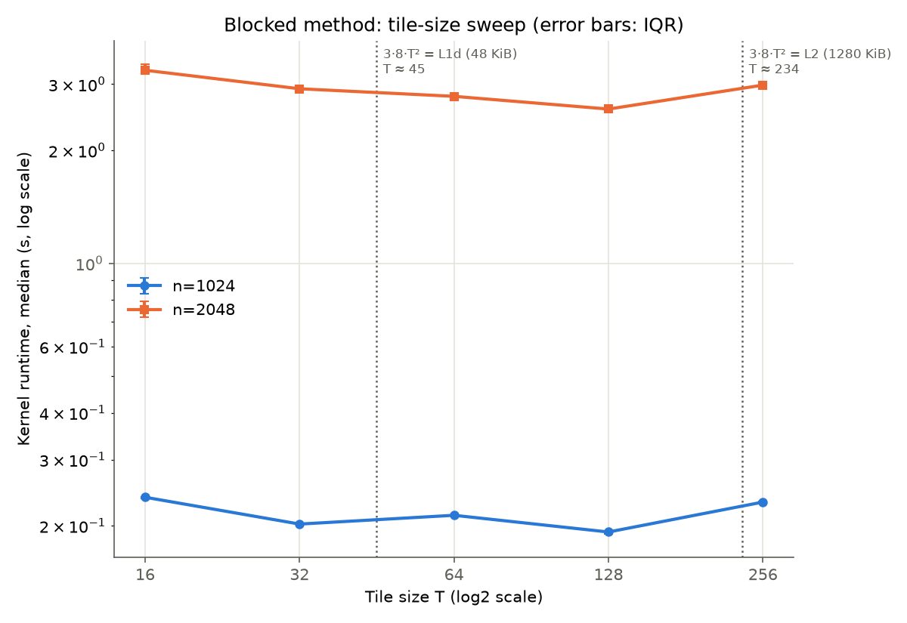
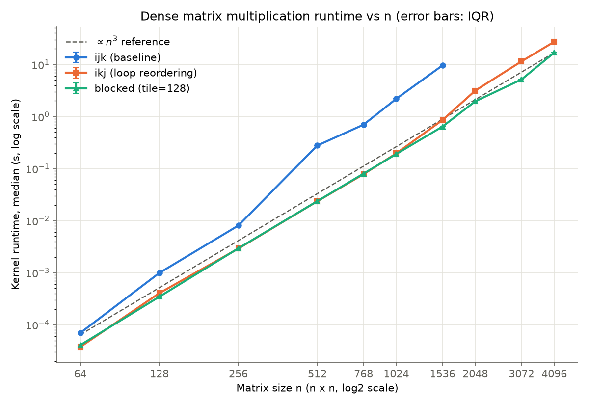
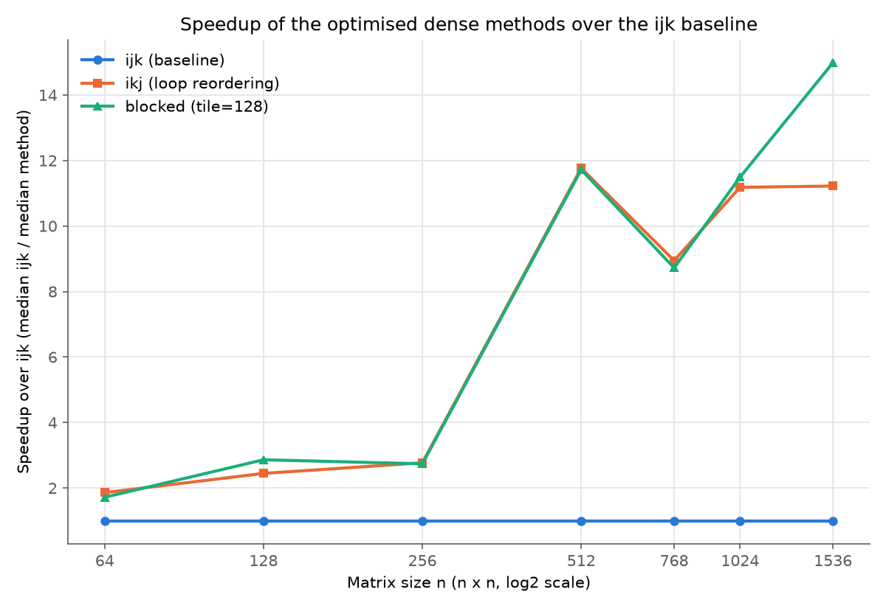
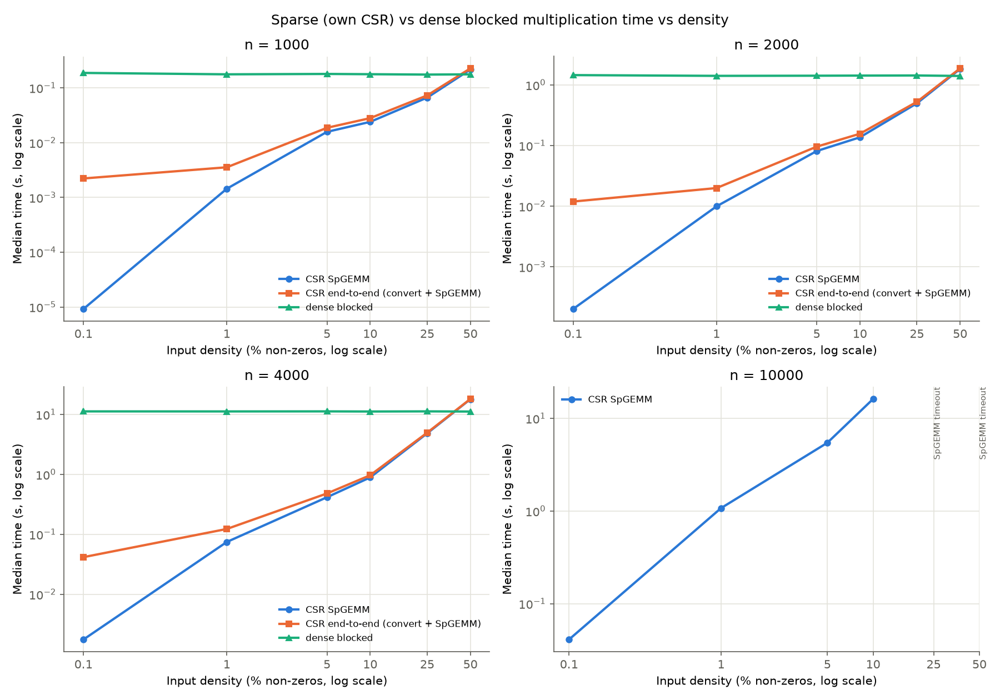
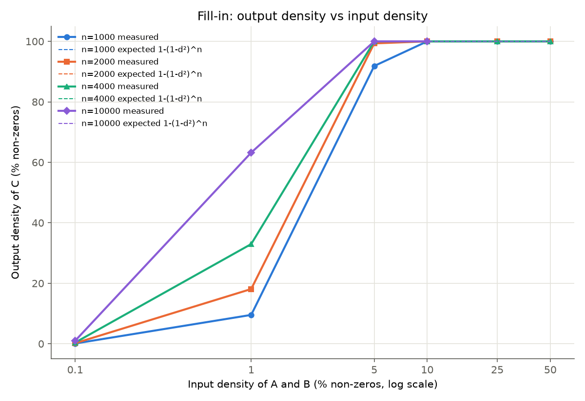
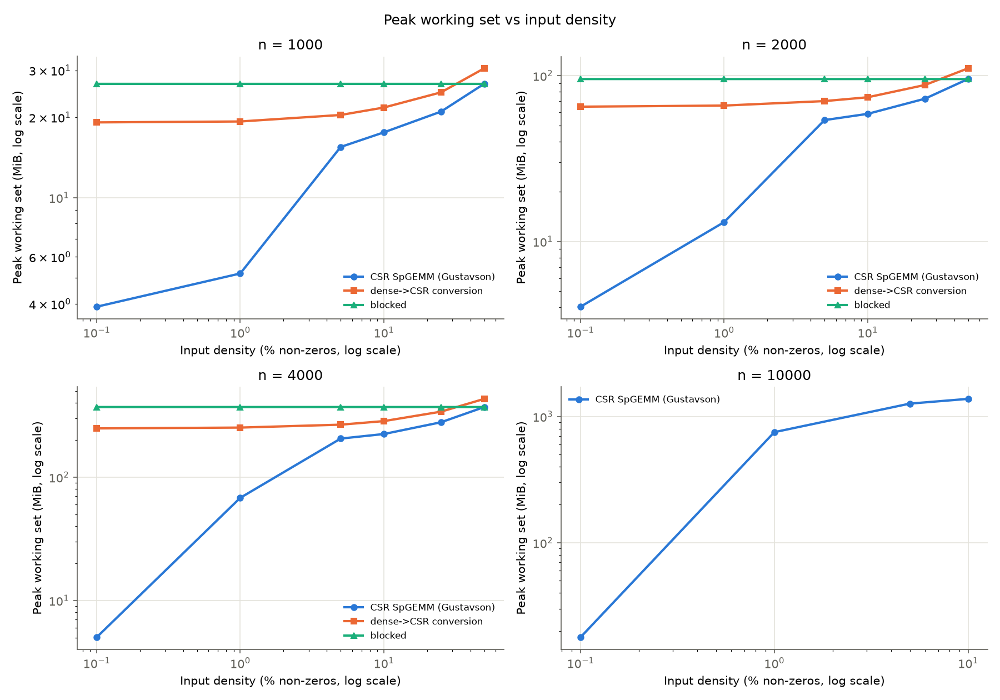

# Loop Reordering, Cache Blocking and CSR Storage: When Do They Speed Up Sequential Matrix Multiplication in C?

**Author:** Joel López Guillén

**Assignment:** 2 — Optimised Matrix Multiplication Approaches and Sparse Matrices

**Course:** BIG DATA, Grado en Ciencia e Ingeniería de Datos, Universidad de Las Palmas de Gran Canaria, 2026-2027

**Repository:** https://github.com/JoelLopezGuillen/big-data-matrix-multiplication

**Materials:** source code, raw measurements and analysis scripts at the repository tag `assignment-2` (https://github.com/JoelLopezGuillen/big-data-matrix-multiplication/tree/assignment-2)

---

## Abstract

This study asks two questions about sequential float64 matrix multiplication in C on one laptop
(Intel Core i7-12650H, Windows 11). First, how much do loop reordering (i-k-j) and cache blocking improve
on the naive i-j-k kernel validated in Assignment 1? Second, under which tested conditions does an own
CSR implementation (dense-to-CSR conversion plus Gustavson SpGEMM) beat the dense blocked kernel on the
same matrices? All kernels were validated against NumPy and SciPy and timed as one warm-up plus five
repetitions (median and IQR), with a 60 s limit per kernel execution and a 4 GiB memory budget.
Reordering the loops (i-k-j instead of i-j-k) made the kernel between 8.9 and 11.8 times faster than the
baseline for n = 512 to 1536. Blocking with the best tile (T = 128, not the L1d-sized
tile we predicted) matched i-k-j while the data fitted in cache and was 1.3–2.2× faster from n = 1536.
The largest feasible size was 1536 for i-j-k and 4096 (the largest attempted) for the optimised kernels.
For uniformly random sparse inputs, CSR was faster than dense up to 25 % density and slower at 50 % for
n = 1000, 2000 and 4000. The advantage depended on n and on output fill-in, not only on the percentage of zeros.
These conclusions apply only to the tested kernels, inputs and machine.

## 1. Introduction and objective

The naive i-j-k kernel of Assignment 1 [16] showed that its runtime is dominated by where matrix B
sits in the memory hierarchy, not by the n³ operation count. This study asks whether changing the
access pattern, or the storage format when most entries are zero, removes that cost. Part A changes
the loop order and the traversal of the matrices without changing the arithmetic. Part B changes the
representation, so that only non-zero entries are stored and multiplied.

**Research questions.**

- **RQ1.** How much do loop reordering (i-k-j) and cache blocking reduce the runtime of the
  i-j-k baseline as n grows, and what is the largest feasible size of each method under the declared budget?
- **RQ2.** Which tile size is best for the blocked kernel, and how does it relate to the L1d and L2 cache sizes?
- **RQ3.** For matched random sparse inputs, at which densities is an own CSR SpGEMM faster and smaller in
  memory than the dense blocked kernel, and how do size, conversion and output fill-in change the answer?

**Hypotheses (predictions stated before the results were analysed).**

- **H1.** i-k-j is much faster than i-j-k once B no longer fits in L2 (n ≥ 512), because it replaces the
  stride-n column walk of B with unit-stride row walks. For small n the gain should be smaller.
- **H2.** Blocking gives no gain over i-k-j while the matrices fit in cache. It is faster only once
  the data streamed for each row of C no longer fits in the last-level cache.
- **H3.** The best tile is T = 64, for which one tile (32 KiB) fits in the 48 KiB L1d cache.
- **H4.** CSR is faster than dense at low density and slower at high density. The advantage shrinks as the
  density d grows, because SpGEMM work grows as d²n³ and each sparse operation costs more than a dense one.
- **H5.** The product becomes denser than the inputs (fill-in), so the memory advantage of CSR disappears
  once C is nearly dense.

## 2. Background

**Locality and the cache hierarchy.** Caches keep recently used data close to the processor and move it
in 64-byte lines [3], [4]. A program is fast when it reuses data while it is still cached (temporal
locality) and reads consecutive addresses (spatial locality). Matrices are stored row-major, so walking a
row is cheap and walking a column touches a new cache line at every step. On the test machine each P-core
has a 48 KiB L1d and a 1.25 MiB L2 cache, and all cores share a 24 MiB L3 [2], [14].

**Loop reordering.** The three loops of C = AB can be nested in any order without changing the result
(up to floating-point rounding). In the i-k-j order the inner loop computes `C[i][j] += A[i][k] * B[k][j]`
over j, so both B and C are read along rows with unit stride and `A[i][k]` stays in a register [3].
The work is still n³ multiply-adds. Only the memory access pattern changes.

**Cache blocking (tiling).** Even with unit stride, i-k-j streams all of B (8n² bytes) once for every row
of C. When B is larger than a cache level, it is reloaded from the next level n times. Blocking splits
the loops into T × T tiles so that a tile of B is reused for T rows of C while it is still cached [5].
Lam, Rothberg and Wolf showed that the best tile depends on the cache size and on the matrix size and
stride, because of self-interference (conflict) misses. They also showed that filling the whole cache, or a
fixed fraction of it, is not a reliable rule [5]. High-performance libraries build on the same idea with
several levels of blocking and packed buffers [6].

**CSR format.** Compressed Sparse Row stores a matrix with nnz non-zeros in three arrays: the values,
their column indices, and a row-pointer array of length n + 1 that marks where each row starts [7].
Here the values are float64, the column indices int32 and the row pointers int64, i.e. 12 bytes per
non-zero plus 8(n + 1) bytes, compared with 8n² bytes for the dense form.

**Gustavson SpGEMM.** Gustavson's algorithm builds C row by row: row i of C is the sum of the rows k of B
scaled by each non-zero `A[i][k]` [8]. Only products of two non-zeros are computed. For uniformly random
inputs of density d, the expected number of multiply-adds is d²n³, compared with n³ for a dense kernel.
The cost per operation is higher, because each product needs an index lookup and an irregular write into
an accumulator.

**Output fill-in.** An entry C[i][j] is structurally non-zero if at least one of the n products
A[i][k]B[k][j] has two non-zero factors. If entries are independent with probability d, each product is
non-zero with probability d², so the expected output density is 1 − (1 − d²)ⁿ. This value grows with n as well as with d:
for d = 1 % it is 9.5 % at n = 1000 but 63 % at n = 10000. Once C is dense, CSR stores it with
12 bytes per entry instead of 8.

## 3. Methodology

### 3.1 Implementations (own code vs libraries)

All timed code is our own C code (`c/matmul.c`, `c/csr.c`), compiled with gcc, float64 and one thread.
NumPy [10] and SciPy [9] are used only as correctness references, and NumPy also for input generation and
analysis. No library kernel is benchmarked.

| Method | Description |
|---|---|
| `ijk` (baseline) | Assignment 1 C kernel (tag `assignment-1`), copied verbatim and only renamed: dot product in a local accumulator, B read by columns |
| `ikj` | loop reordering: `A[i][k]` hoisted, inner loop over j adds `a_ik * B[k][j]` into row i of C with unit stride |
| `blocked` | cache blocking with square T × T tiles: tile loops ii-kk-jj, i-k-j micro-kernel inside each tile, shorter edge tiles when T does not divide n |
| `dense_to_csr` | own conversion of A and B: one pass counts the non-zeros, then exact allocation, then a second pass fills the arrays |
| `csr_gustavson` | own SpGEMM: symbolic pass (nnz of each row of C, using a marker array), exact allocation of C, numeric pass with a dense accumulator and marker, column indices sorted per row (insertion sort or `qsort`, or a linear scan of the marker array when a row fills at least 1/64 of the columns) |

The three dense kernels allocate and zero-initialise C with `calloc` inside the function, as in Assignment 1.
The SpGEMM keeps every *structural* non-zero, including entries whose products cancel to exactly 0.0.
SciPy drops such entries, so the cross-check handles both cases (Section 3.5).

### 3.2 Inputs

- **Dense inputs (Part A).** Reused from Assignment 1: `data/generate.py` writes `A_n{n}.bin` and
  `B_n{n}.bin` with NumPy `default_rng` (PCG64), values uniform in [−1, 1), seeds 42 (A) and 43 (B),
  raw little-endian float64 in row-major order. All three methods read the same files.
- **Sparse inputs (Part B).** `data/generate_sparse.py` draws exactly nnz = round(d·n²) distinct positions
  uniformly without replacement, then values uniform in [−1, 1), redrawing any exact 0.0 (seeds 42 and 43).
  Each matrix is written in CSR and, for the sizes compared with dense, also as a dense file holding the
  same matrix (its dense twin), so that both methods multiply identical inputs. Parameters are recorded
  in `data/sparse/manifest.json`. Density is the percentage of non-zero entries and sparsity the
  percentage of zeros (100 − density).
- **Sizes.** Part A: n = 64, 128, 256, 512, 768, 1024, 1536, 2048, 3072, 4096. Tile sweep: T = 16, 32,
  64, 128, 256 at n = 1024 and 2048. Part B: densities 0.1, 1, 5, 10, 25 and 50 % at n = 1000, 2000 and
  4000 (CSR and dense blocked with the tile chosen in the sweep), plus n = 10000 for CSR only (no dense twin
  is generated at that size, so the dense run and the conversion were not run by design).

### 3.3 Environment

| Item | Value |
|---|---|
| CPU | Intel Core i7-12650H: 6 P-cores (Hyper-Threading) and 4 E-cores; 10 physical cores, 16 logical processors |
| Caches (P-core) | L1d 48 KiB and L2 1.25 MiB per core; L3 24 MiB shared; 64-byte lines (`tools/cache_info.json` [14]) |
| RAM | 15.7 GiB |
| OS | Windows 11 (build 10.0.26200) |
| Compiler | gcc 16.1.0 (MSYS2 UCRT64), `-O2 -std=c11 -Wall -Wextra`, no `-march=native` |
| Python tools | CPython 3.13.7, NumPy 2.5.4, SciPy 1.18.1 (references only), psutil 7.2.2 |
| Execution | 1 thread; process pinned to the P-core logical processors 0–11 (found with `GetSystemCpuSetInformation` [13]), high priority |
| Runs | 2026-10-21: tile sweep from 19:25, dense from 19:48, sparse from 20:01 |

The harness records a note in the CSV if CPU affinity or priority cannot be applied. No such note appears
in any of the three result files, so pinning was in effect for all reported data. This addresses a
limitation of Assignment 1.

### 3.4 Measurement protocol and budgets

- **Timing boundary.** One kernel call is timed with `QueryPerformanceCounter` (100 ns resolution [12]).
  Dense kernels and SpGEMM include the allocation of C. The conversion includes the allocation of both
  CSR matrices. Input loading, checksums and `free` are outside the timed region. The CSR end-to-end time is
  *derived* as median conversion + median SpGEMM. It is not a separate measured run, and it is never mixed
  with the kernel-only times without being labelled.
- **Repetitions.** One child process per configuration loads the inputs, runs 1 warm-up (excluded) and
  5 measured repetitions, and prints a checksum of C after every repetition so that the work cannot be
  eliminated. We report the median and the interquartile range (IQR = Q3 − Q1). All raw rows are kept in
  `results/{tiles,dense,sparse}/raw_measurements.csv`.
- **Memory metric.** Peak working set (`peak_wset`) of the child process, read with psutil [11] by the
  harness while the child waits on stdin after printing its results. This is the operating system's peak
  counter for the whole process (inputs, output, workspace and runtime) over the warm-up and all
  repetitions, not the storage of the output alone.
- **Budgets (declared before measuring).** Time: 60 s per kernel execution. The deadline restarts after
  every warm-up or repetition, and a single execution above 60 s kills the process and is recorded as
  `timeout` with no time. Memory: 4 GiB peak working set. The estimate (3·8n² bytes for dense; CSR inputs
  plus a CSR output with the expected nnz for SpGEMM) is checked before launch. While the process runs, its working set is
  polled every 0.25 s and the process is killed above the budget. After a failure at size n, larger sizes
  of the same series are recorded as `skipped_after_<status>`.

### 3.5 Correctness

The C unit tests (`c/test_matmul.c`) cover identity, zero and hand-computed 1×1, 2×2 and 3×3 products
for every dense method. They check that all methods agree with `ijk` for n = 1, 7, 63, 64, 65 and 130
with tiles 16, 64 and 128 (including edge tiles), and that tile = 0 is rejected. For CSR they cover a known
conversion with an empty row, the dense→CSR→dense round trip, all-zero and identity matrices, a known
product, a structural zero created by cancellation, a shape mismatch, SpGEMM against dense `ijk` on random
matrices, and the file round trip.

`cross_check.py` compares every dense method (tiles 16, 64, 128) with NumPy `A @ B` for n = 64, 100 and
130. For n = 50 and 200 at all six densities, it checks that the own conversion reproduces the generated
CSR exactly and compares the own SpGEMM with `scipy.sparse` `A @ B`. That comparison covers the values,
the sorted CSR structure, the structural nnz (equal to the nnz of the boolean product pattern) and the
entries that are numerically non-zero (a disagreement is allowed only for entries within atol of zero, because SciPy
drops exact zeros). As in Assignment 1, values must satisfy `numpy.allclose` with rtol = 10⁻⁹ and
atol = 10⁻¹². The rounding error from a different summation order is about n·2⁻⁵³ relative (around
10⁻¹³ here), while an indexing error produces O(1) differences. In the stored cross-check outputs the
largest dense difference was 1.6 × 10⁻¹⁴. The SpGEMM values were identical to SciPy's, and the structural nnz matched
SciPy's in all twelve sparse cases (no exact cancellation occurred in these inputs; it is covered by the unit test).

## 4. Results

### 4.1 Tile sweep (Part A)

**Table 1.** Blocked kernel runtime against tile size: median and IQR of 5 repetitions (seconds). The
last column is the size of the three T × T tiles touched by the micro-kernel (3·8T² bytes).

| T | n = 1024 median | IQR | n = 2048 median | IQR | Three tiles |
|---|---|---|---|---|---|
| 16 | 0.238 | 0.0024 | 3.27 | 0.134 | 6 KiB |
| 32 | 0.202 | 0.0006 | 2.92 | 0.009 | 24 KiB |
| 64 | 0.213 | 0.0005 | 2.78 | 0.038 | 96 KiB |
| **128** | **0.193** | 0.0028 | **2.58** | 0.045 | 384 KiB |
| 256 | 0.231 | 0.0009 | 2.98 | 0.095 | 1.5 MiB |

**Figure 1.** Blocked kernel runtime against tile size at n = 1024 and 2048 (log scales, IQR error bars).
The dotted lines mark where three tiles fill the L1d (T ≈ 45) and the L2 (T ≈ 234).

T = 128 was the fastest tile at both sizes and was used for every later blocked run. It was 5 % faster than
the second-best tile at n = 1024 (T = 32) and 8 % faster than the second-best at n = 2048 (T = 64). H3 is therefore rejected.

### 4.2 Dense methods (Part A)

**Table 2.** Kernel runtime: median and IQR of 5 repetitions (seconds). Blocked uses T = 128.
Timeout = one kernel execution exceeded 60 s.

| n | ijk median | ijk IQR | ikj median | ikj IQR | blocked median | blocked IQR |
|---|---|---|---|---|---|---|
| 64 | 0.0000699 | 0.0000021 | 0.0000376 | 0.0000001 | 0.0000407 | 0.0000037 |
| 128 | 0.000991 | 0.000003 | 0.000405 | 0.000001 | 0.000346 | 0.000042 |
| 256 | 0.00806 | 0.00037 | 0.00291 | 0.000004 | 0.00294 | 0.00007 |
| 512 | 0.278 | 0.001 | 0.0236 | 0.0004 | 0.0237 | 0.0002 |
| 768 | 0.697 | 0.055 | 0.0780 | 0.0013 | 0.0800 | 0.0019 |
| 1024 | 2.19 | 0.05 | 0.196 | 0.001 | 0.191 | 0.002 |
| 1536 | 9.61 | 0.08 | 0.856 | 0.017 | 0.641 | 0.007 |
| 2048 | timeout | — | 3.15 | 0.02 | 1.96 | 0.02 |
| 3072 | skipped | — | 11.48 | 0.18 | 5.15 | 0.02 |
| 4096 | skipped | — | 27.31 | 0.09 | 16.91 | 0.05 |

The largest feasible tested size was n = 1536 for ijk (its first execution at n = 2048 exceeded 60 s)
and n = 4096 for ikj and blocked. The largest size attempted was 4096 for the optimised methods and 2048 for ijk.
The memory budget was never reached: the estimate at n = 4096 is 384 MiB.

**Table 3.** Time per inner-loop iteration T/n³ (nanoseconds) and speedups ("X vs Y" = median time of Y /
median time of X). The size of B (8n² bytes) is shown for reference.

| n | Size of B | ijk | ikj | blocked | ikj vs ijk | blocked vs ijk | blocked vs ikj |
|---|---|---|---|---|---|---|---|
| 64 | 32 KiB | 0.27 | 0.14 | 0.16 | 1.86 | 1.72 | 0.92 |
| 128 | 128 KiB | 0.47 | 0.19 | 0.17 | 2.45 | 2.86 | 1.17 |
| 256 | 512 KiB | 0.48 | 0.17 | 0.18 | 2.77 | 2.74 | 0.99 |
| 512 | 2 MiB | 2.07 | 0.18 | 0.18 | 11.76 | 11.72 | 1.00 |
| 768 | 4.5 MiB | 1.54 | 0.17 | 0.18 | 8.94 | 8.72 | 0.98 |
| 1024 | 8 MiB | 2.04 | 0.18 | 0.18 | 11.18 | 11.49 | 1.03 |
| 1536 | 18 MiB | 2.65 | 0.24 | 0.18 | 11.22 | 14.98 | 1.34 |
| 2048 | 32 MiB | — | 0.37 | 0.23 | — | — | 1.61 |
| 3072 | 72 MiB | — | 0.40 | 0.18 | — | — | 2.23 |
| 4096 | 128 MiB | — | 0.40 | 0.25 | — | — | 1.61 |

**Figure 2.** Dense kernel runtime against n (log-log scale, IQR error bars).

**Figure 3.** Speedup of ikj and blocked over ijk (median ijk / median method), for the sizes where ijk completed.

Variability within a run was low. From n = 256 the IQR was at most 2.4 % of the median for ikj and
blocked, and at most 7.9 % for ijk (n = 768). The larger relative IQRs at n = 64–128 (up to 12 %) are
absolute spreads of at most 42 µs. The peak working set was the same for the three methods at each size, from
3.9 MiB at n = 64 to 387.8 MiB at n = 4096, close to the 384 MiB of A, B and C
(`results/dense/memory_vs_n.png`).

### 4.3 Run-to-run variation

The blocked kernel with T = 128 was measured in two separate runs. At n = 1024 the two medians agree
within 1 % (0.193 s in the tile sweep, 0.191 s in the dense run). At n = 2048 they differ by 31 %:
2.58 s (IQR 0.045 s) in the tile sweep and 1.96 s (IQR 0.018 s) in the later dense run. Both
IQRs are small, so the difference lies between runs, not within them. A likely cause is a different
turbo, thermal or power state of the laptop, but frequency and temperature were not recorded. Therefore
we only compare methods within a run: the tile sweep is used only to rank tiles, and the dense and
sparse results are each compared within their own run.

### 4.4 Sparse vs dense (Part B)

**Table 4.** Own CSR vs dense blocked (T = 128) on the same matrices: medians of 5 repetitions (seconds).
Output density is measured / expected, with expected = 1 − (1 − d²)ⁿ. End-to-end = convert + SpGEMM (derived).
The last column is the dense time divided by the CSR end-to-end time (> 1 means CSR is faster).

| n | d (%) | nnz A (= nnz B) | nnz C | C density (%) | SpGEMM | Convert A+B | End-to-end | Dense | Dense / end-to-end |
|---|---|---|---|---|---|---|---|---|---|
| 1000 | 0.1 | 1 000 | 958 | 0.096 / 0.100 | 0.0000092 | 0.00221 | 0.00222 | 0.187 | 84.4 |
| 1000 | 1 | 10 000 | 95 440 | 9.54 / 9.52 | 0.00144 | 0.00211 | 0.00355 | 0.176 | 49.7 |
| 1000 | 5 | 50 000 | 918 565 | 91.9 / 91.8 | 0.0157 | 0.00291 | 0.0186 | 0.179 | 9.62 |
| 1000 | 10 | 100 000 | 999 958 | 99.996 / 99.996 | 0.0239 | 0.00405 | 0.0280 | 0.177 | 6.34 |
| 1000 | 25 | 250 000 | 1 000 000 | 100 / 100 | 0.0663 | 0.00644 | 0.0727 | 0.175 | 2.40 |
| 1000 | 50 | 500 000 | 1 000 000 | 100 / 100 | 0.216 | 0.0101 | 0.226 | 0.176 | 0.78 |
| 2000 | 0.1 | 4 000 | 7 868 | 0.197 / 0.200 | 0.000201 | 0.0117 | 0.0119 | 1.446 | 122 |
| 2000 | 1 | 40 000 | 724 188 | 18.1 / 18.1 | 0.00991 | 0.00993 | 0.0198 | 1.406 | 70.9 |
| 2000 | 5 | 200 000 | 3 973 101 | 99.3 / 99.3 | 0.0809 | 0.0147 | 0.0956 | 1.414 | 14.8 |
| 2000 | 10 | 400 000 | 4 000 000 | 100 / 100 | 0.136 | 0.0197 | 0.156 | 1.420 | 9.11 |
| 2000 | 25 | 1 000 000 | 4 000 000 | 100 / 100 | 0.496 | 0.0282 | 0.524 | 1.427 | 2.72 |
| 2000 | 50 | 2 000 000 | 4 000 000 | 100 / 100 | 1.823 | 0.0415 | 1.865 | 1.400 | 0.75 |
| 4000 | 0.1 | 16 000 | 64 204 | 0.401 / 0.399 | 0.00176 | 0.0398 | 0.0416 | 11.24 | 270 |
| 4000 | 1 | 160 000 | 5 275 068 | 33.0 / 33.0 | 0.0745 | 0.0483 | 0.123 | 11.22 | 91.4 |
| 4000 | 5 | 800 000 | 15 999 280 | 99.996 / 99.996 | 0.416 | 0.0650 | 0.481 | 11.25 | 23.4 |
| 4000 | 10 | 1 600 000 | 16 000 000 | 100 / 100 | 0.889 | 0.0779 | 0.967 | 11.19 | 11.6 |
| 4000 | 25 | 4 000 000 | 16 000 000 | 100 / 100 | 4.844 | 0.119 | 4.963 | 11.25 | 2.27 |
| 4000 | 50 | 8 000 000 | 16 000 000 | 100 / 100 | 17.953 | 0.161 | 18.114 | 11.17 | 0.62 |
| 10000 | 0.1 | 100 000 | 994 450 | 0.994 / 0.995 | 0.0410 | not run | — | not run | — |
| 10000 | 1 | 1 000 000 | 63 211 362 | 63.2 / 63.2 | 1.074 | not run | — | not run | — |
| 10000 | 5 | 5 000 000 | 100 000 000 | 100 / 100 | 5.449 | not run | — | not run | — |
| 10000 | 10 | 10 000 000 | 100 000 000 | 100 / 100 | 16.187 | not run | — | not run | — |
| 10000 | 25 | 25 000 000 | — | — / 100 | timeout | not run | — | not run | — |
| 10000 | 50 | 50 000 000 | — | — / 100 | timeout | not run | — | not run | — |

Within-run variability was low except for the shortest runs. From 1 % density the SpGEMM IQR was at most
5.4 % of the median (n = 2000, 50 %). At 0.1 % the SpGEMM takes microseconds and the relative IQR
reached 73 % at n = 1000 (6.7 µs). The dense IQR was at most 13 % (n = 1000, 0.1 %, a 25 ms spread) and
at most 5.2 % elsewhere. All IQRs are in `results/sparse/summary.md`. At n = 10000 the CSR kernel was
feasible up to 10 % density (16.2 s); at 25 % and 50 % its first execution exceeded 60 s.

**Figure 4.** SpGEMM, CSR end-to-end and dense blocked times against input density for each n (log scales).

**Figure 5.** Measured output density of C against input density, with the expected 1 − (1 − d²)ⁿ (dashed;
the measured and expected curves overlap).

**Table 5.** Cost per multiply-add (nanoseconds): SpGEMM time / (d²n³) and dense time / n³.

| d (%) | SpGEMM n = 1000 | n = 2000 | n = 4000 | n = 10000 | Dense blocked (all d) |
|---|---|---|---|---|---|
| 0.1 | 9.2 | 25.2 | 27.5 | 41.0 | 0.175–0.187 |
| 1 | 14.4 | 12.4 | 11.6 | 10.7 | |
| 5 | 6.3 | 4.0 | 2.6 | 2.2 | |
| 10 | 2.4 | 1.7 | 1.4 | 1.6 | |
| 25 | 1.06 | 0.99 | 1.21 | — | |
| 50 | 0.86 | 0.91 | 1.12 | — | |

**Table 6.** Peak working set of the benchmark process (MiB). The dense value did not depend on density.
The conversion process also holds the two dense inputs.

| d (%) | SpGEMM n = 1000 | n = 2000 | n = 4000 | n = 10000 | Conversion n = 4000 |
|---|---|---|---|---|---|
| 0.1 | 3.9 | 4.0 | 5.0 | 17.8 | 248.4 |
| 1 | 5.2 | 13.1 | 68.0 | 750.4 | 252.2 |
| 5 | 15.5 | 53.9 | 205.3 | 1263.0 | 266.3 |
| 10 | 17.6 | 58.8 | 223.7 | 1377.4 | 284.6 |
| 25 | 21.0 | 72.5 | 278.6 | — | 339.5 |
| 50 | 26.7 | 95.4 | 370.1 | — | 431.1 |
| Dense blocked | 26.7 | 95.3–95.4 | 370.0 | not run | |

**Figure 6.** Peak working set of the SpGEMM, conversion and dense blocked processes against input density.

## 5. Discussion

### 5.1 Effects of the optimisations (Part A)

**Loop reordering (H1).** Supported. i-k-j was 1.9–2.8× faster than i-j-k for n ≤ 256 and 8.9–11.8×
faster for n = 512–1536 (Table 3). The jump coincides with the step already seen in Assignment 1 [16]. The
ijk time grew 34× from n = 256 to 512 for 8× more operations, and its cost per iteration rose from
0.48 to 2.07 ns as B (512 KiB → 2 MiB) left the L2 cache. ikj stayed at 0.14–0.19 ns per iteration up to n = 1024, i.e.
it followed n³, because each inner iteration reads consecutive elements of B and C. ijk at n = 768
(1.54 ns) was cheaper than at 512 and 1024 (about 2.05 ns), although B is larger than L2 at all three sizes.
This is consistent with the suspicion from Assignment 1 that power-of-two strides add conflict misses to the
column walk [5]. ikj deviated from n³ when B approached and then exceeded the L3: 0.24 ns at n = 1536
(18 MiB) and about 0.4 ns from n = 2048 (32 MiB > 24 MiB). At those sizes most of B has to come from
main memory again for every row of C.

**Cache blocking (H2).** Supported. Blocked and ikj were within 3 % of each other from n = 256 to 1024,
where B fits in L2 or L3, so blocking adds nothing when no data has to be re-fetched from a slower level.
From n = 1536 blocked was 1.34–2.23× faster than ikj, and its cost per iteration stayed at about 0.18 ns at
n = 1536 and 3072. A tile of B is reused for 128 rows of C while it is cached, instead of being reloaded for
every row. Blocking was slower per iteration at n = 2048 and 4096 (0.23–0.25 ns) than at 3072 (0.18 ns).
This matches Lam et al.'s observation that power-of-two leading dimensions map the rows of a tile to the
same cache sets [5]. We did not measure cache misses, so this remains a plausible explanation, not a
proven one. Blocking raised the gain over ijk to 15× at n = 1536. Both optimised kernels made
n = 4096 feasible within the budget (27.3 s and 16.9 s), while ijk already exceeded 60 s at n = 2048.

**Tile size (H3).** Rejected: T = 128 was best at both n, not the L1d-sized T = 64 (or T ≈ 45 if all three
tiles had to fit in L1d). A plausible explanation follows from the access pattern of the micro-kernel.
The innermost loop touches only one row segment of the B tile and one of C (2·8T = 2 KiB at T = 128),
which fits easily in L1d. The data that must stay cached for reuse across the i loop is the whole B tile
(128 KiB). Three 128 × 128 tiles occupy 384 KiB, which fits in the 1.25 MiB L2, while three 256 × 256 tiles
(1.5 MiB) do not, and T = 256 was slower again. Small tiles (16, 32) lose for another reason: the j
loop is only 16–32 elements long, so loop overhead and the start-up of the inner loop weigh more.
GCC enables vectorisation at `-O2` [15], but we did not inspect the generated code. Without hardware
counters this explanation is plausible, not proven.

### 5.2 Effects of sparse storage and input structure (Part B)

These results compare a different representation and algorithm with the best dense kernel of Part A.
They do not measure an optimisation of the same dense algorithm.

**Where CSR helps (H4).** Supported, with a crossover at a high density. The dense time was independent of
density (0.175–0.187 s at n = 1000, 1.40–1.45 s at n = 2000, 11.17–11.25 s at n = 4000), because the
dense kernel multiplies zeros like any other value. CSR end-to-end was faster than dense at every density
up to 25 % for all three sizes, by 84–270× at 0.1 % and by 2.3–2.7× at 25 %. It was slower at 50 %
(0.62–0.78×). The crossover therefore lies between 25 % and 50 %. With only these two points, its
exact location is not determined.

**Why the advantage shrinks.** At 25 % density the SpGEMM performs d² = 6.25 % of the dense
multiply-adds, yet it was only 2.3–2.9× faster than dense, not 16×. Table 5 shows why: each sparse
multiply-add cost 1.0–1.2 ns, 5.6–6.9× more than a dense one (about 0.18 ns). The extra cost comes from
the column-index load and the indirect, irregular update `acc[j] += ...` with its marker check, which the
dense kernel does not need. At very low density the cost per operation was higher still (9–41 ns). In
that regime the fixed per-row work, such as row-pointer reads, marker handling and sorting, dominates the
few products. At 25 % the SpGEMM time grew 7.5× and 9.8× per doubling of n, close to the 8× of the dense
kernel, so the speedup over dense stayed roughly constant with n at high density.

**Fill-in and memory (H5).** Supported. The measured output density matched 1 − (1 − d²)ⁿ closely at
every point (Table 4, Figure 5). Fill-in depends strongly on n: at 1 % input density C was 9.5 % dense at
n = 1000, 33 % at n = 4000 and 63 % at n = 10000. At n = 4000, 5 % input density already produced an
essentially dense output (99.996 %). The memory advantage of CSR was therefore large only while C stayed
sparse: at n = 4000 the SpGEMM process peaked at 5.0 MiB at 0.1 %, against 370.0 MiB for dense. Once C is
dense, CSR stores it with 12 bytes per entry instead of 8, and at 50 % the inputs need 6 bytes per entry.
The peak working set was then equal to dense (370.1 vs 370.0 MiB at n = 4000; 95.4 vs 95.3 MiB at
n = 2000). At n = 10000, a dense C in CSR alone needs 1.1 GiB, and the process peaked at 1.35 GiB at 10 %.

**Conversion cost.** Converting A and B from dense scans all n² entries of each matrix, so its cost depends
mainly on n (2.2, 11.7 and 39.8 ms at 0.1 %). At 0.1 % it was 23–240× longer than the SpGEMM itself
and dominated the end-to-end time. CSR was still 84–270× faster than dense, so conversion did not move
the crossover: the dense / end-to-end ratios at 25 % and 50 % (Table 4) differ from the dense / SpGEMM
ratios by less than 10 %. Its memory cost is larger than its time cost, because the conversion process holds
both dense inputs (248–431 MiB at n = 4000).

**Density alone does not determine performance.** The same density gave very different outcomes
depending on n and on the output. At 1 % the CSR end-to-end speedup was 50× at n = 1000 and 91× at
n = 4000. At 5 % the output was 92 % dense at n = 1000 but fully dense at n = 4000, which changed the
memory picture from sparse to dense. At n = 10000 the CSR kernel exceeded the 60 s budget at 25 %,
a density at which it was 2.3–2.9× faster than dense at smaller n. The cost per operation, fill-in and
the absolute work d²n³ all matter, and these results hold only for uniformly random positions.

### 5.3 Limitations

- All data come from one laptop. Run-to-run differences of up to 31 % were seen between runs
  (Section 4.3), so only within-run comparisons are made. Frequency, temperature and power state were not recorded.
- No hardware performance counters were used: the cache explanations are consistent with the timings but
  not proven, and the power-of-two effects are inferred from only a few sizes.
- Only one sparsity pattern was tested (uniform random positions). Structured matrices (banded,
  block-diagonal, power-law degree distributions) have different fill-in and locality and may behave
  very differently.
- Part B compared CSR with one dense method (blocked, T = 128). The density crossover is located only
  between 25 % and 50 %.
- All code is sequential, and vectorisation was left to the compiler without inspection.
- The peak working set covers the whole process, including the loaded inputs. The 0.25 s polling used to
  enforce the memory budget could miss a short spike. The reported peak itself is the operating system's counter.
- The cross-check against NumPy and SciPy used small sizes (n ≤ 200). Larger sizes rely on the unit tests
  and on the checksums printed for each repetition, which were bit-identical across all dense methods at
  every size where they ran, as expected because all three accumulate each element of C in the same
  increasing order of k.

## 6. Conclusions

Within the tested scope (one Intel Core i7-12650H laptop, Windows 11, gcc 16.1.0 `-O2`, float64, one thread,
dense n = 64–4096 and uniformly random sparse inputs with n = 1000–10000), the study establishes that:

1. Loop reordering to i-k-j removes the column-stride penalty of the naive kernel. It was 8.9–11.8× faster
   than i-j-k from n = 512 to 1536 and followed n³ up to n = 1024.
2. Cache blocking only helped once B approached or exceeded the L3 cache (from n = 1536). It was then
   1.3–2.2× faster than i-k-j. Both optimisations raised the largest feasible size from 1536 (i-j-k) to 4096, the
   largest size attempted.
3. The best tile was T = 128, whose working set fits in L2 rather than L1d. The prediction that an
   L1d-sized tile would be best was wrong for this micro-kernel.
4. For uniformly random inputs, the own CSR SpGEMM, including conversion, was faster than the dense
   blocked kernel up to 25 % density and slower at 50 % for n = 1000, 2000 and 4000, even though it does
   d² of the dense work. At 25–50 % density each sparse operation cost about 5–7× more than a dense one,
   and at lower densities 8–230× more (Table 5).
5. Output fill-in follows 1 − (1 − d²)ⁿ and grows with n. Once C is dense, CSR loses its memory advantage
   and its peak memory equals that of dense storage at 50 % density.

The study does not establish the exact density of the crossover, the hardware cause of the
tile-size and power-of-two effects, or how structured sparsity patterns behave. Finer density steps,
hardware counters and structured test matrices would address these questions.

## 7. References

[1] Universidad de Las Palmas de Gran Canaria, "Individual Assignments — Matrix Multiplication," BIG DATA course, revised proposal 2026-2027.

[2] Intel Corporation, "Intel Core i7-12650H Processor (24M Cache, up to 4.70 GHz) — Specifications," Intel ARK. [Online]. Available: https://www.intel.com/content/www/us/en/products/sku/226066/intel-core-i712650h-processor-24m-cache-up-to-4-70-ghz/specifications.html

[3] J. L. Hennessy and D. A. Patterson, *Computer Architecture: A Quantitative Approach*, 6th ed. Cambridge, MA, USA: Morgan Kaufmann, 2017.

[4] U. Drepper, "What Every Programmer Should Know About Memory," Red Hat, Inc., 2007.

[5] M. S. Lam, E. E. Rothberg, and M. E. Wolf, "The cache performance and optimizations of blocked algorithms," in *Proc. 4th Int. Conf. Architectural Support for Programming Languages and Operating Systems (ASPLOS-IV)*, Santa Clara, CA, USA, 1991, pp. 63–74, doi: 10.1145/106972.106981.

[6] K. Goto and R. A. van de Geijn, "Anatomy of high-performance matrix multiplication," *ACM Trans. Math. Softw.*, vol. 34, no. 3, Art. 12, 2008, doi: 10.1145/1356052.1356053.

[7] Y. Saad, *Iterative Methods for Sparse Linear Systems*, 2nd ed. Philadelphia, PA, USA: SIAM, 2003, Sec. 3.4.

[8] F. G. Gustavson, "Two fast algorithms for sparse matrices: Multiplication and permuted transposition," *ACM Trans. Math. Softw.*, vol. 4, no. 3, pp. 250–269, 1978, doi: 10.1145/355791.355796.

[9] P. Virtanen *et al.*, "SciPy 1.0: Fundamental algorithms for scientific computing in Python," *Nature Methods*, vol. 17, no. 3, pp. 261–272, 2020, doi: 10.1038/s41592-019-0686-2.

[10] C. R. Harris *et al.*, "Array programming with NumPy," *Nature*, vol. 585, no. 7825, pp. 357–362, 2020, doi: 10.1038/s41586-020-2649-2.

[11] G. Rodola, "psutil documentation." [Online]. Available: https://psutil.readthedocs.io

[12] Microsoft, "Acquiring high-resolution time stamps," Windows App Development documentation. [Online]. Available: https://learn.microsoft.com/en-us/windows/win32/sysinfo/acquiring-high-resolution-time-stamps

[13] Microsoft, "GetSystemCpuSetInformation function (processthreadsapi.h)," Win32 API documentation. [Online]. Available: https://learn.microsoft.com/en-us/windows/win32/api/processthreadsapi/nf-processthreadsapi-getsystemcpusetinformation

[14] Microsoft, "GetLogicalProcessorInformationEx function (sysinfoapi.h)," Win32 API documentation. [Online]. Available: https://learn.microsoft.com/en-us/windows/win32/api/sysinfoapi/nf-sysinfoapi-getlogicalprocessorinformationex. Values recorded in `tools/cache_info.json`.

[15] Free Software Foundation, "GCC 12 Release Series: Changes, New Features, and Fixes." [Online]. Available: https://gcc.gnu.org/gcc-12/changes.html

[16] J. López Guillén, "How matrix size affects the runtime and memory of naive matrix multiplication in Python, Java and C," BIG DATA Assignment 1 report, Universidad de Las Palmas de Gran Canaria, 2026. Repository tag `assignment-1`.

## 8. Reproducibility materials

All materials are in the repository above, in `assignment-2/`:

- Source code: `c/matmul.c` (dense kernels), `c/csr.c` (CSR, conversion, SpGEMM), `c/runner.c`; unit tests
  `c/test_matmul.c` and `tests/`; harness `benchmark.py` and `bench_common.py`; cross-check `cross_check.py`.
- Inputs: `data/generate.py` (dense, from Assignment 1) and `data/generate_sparse.py`; seeds, formats and
  definitions in `data/README.md`; generated sparse parameters in `data/sparse/manifest.json`.
- Configuration: `bench_config_tiles.json`, `bench_config_dense.json`, `bench_config_sparse.json`.
- Raw data and environment: `results/{tiles,dense,sparse}/raw_measurements.csv` and `environment.json`;
  topology and caches in `tools/cpu_topology.json` and `tools/cache_info.json`.
- Analysis: `results/analyze.py` produces `summary.md`/`summary.csv`, `sparse_comparison.csv` and all figures.
- Report: `report/report.md`, rendered to PDF by `report/build_pdf.py`.

Exact commands, from PowerShell inside `assignment-2/` (as in `assignment-2/README.md`):

| Step | Command |
|---|---|
| Setup | `py -3.13 -m venv .venv` then `.venv\Scripts\python -m pip install -r requirements.txt` |
| Build and test | `.venv\Scripts\python build.py` then `.venv\Scripts\python run_tests.py` |
| Tile sweep | `.venv\Scripts\python benchmark.py --config bench_config_tiles.json` |
| Dense methods | `.venv\Scripts\python benchmark.py --config bench_config_dense.json` |
| Sparse vs dense | `.venv\Scripts\python benchmark.py --config bench_config_sparse.json` |
| Tables and figures | `.venv\Scripts\python results\analyze.py` |
| Report PDF | `.venv\Scripts\python report\build_pdf.py` |

## Generative AI disclosure

In this project, I used generative AI: Claude (Anthropic), through Claude Code. The AI proposed the experimental design (methods, sizes, densities, budgets and timing boundaries), which I reviewed and approved before any measurement was taken. Based on that design, I authorised it to implement the code (the optimised dense kernels, the CSR conversion and SpGEMM, the tests, the benchmark harness and the analysis scripts). At my request, it ran the tile sweep and the dense and sparse benchmarks on my laptop; I chose the tile size (T = 128) from the sweep results. The AI also helped me understand the code and the results, and drafted the text of this report from the stored measurements. I reviewed and edited the report and checked its figures against the raw data.

I have a full understanding of both the code and the conclusions. All numerical results are derived from measurements stored in the repository; none were generated by the AI tool.
